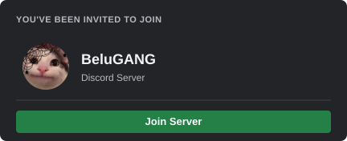

# BeluGANG Level Card

This API is designed for generating level cards and checking link redirects. Originally created as a separate API but later integrated inside the BeluGANG Events bot.

## Contributors

## Endpoints
- `/generate_card` - Generates level cards based on user input.
- `/redirect` - Checks link redirects and provides detailed information.

 
> [!WARNING]  
> When hosting on Vercel, please set the Node version to **18.x** to ensure compatibility.
